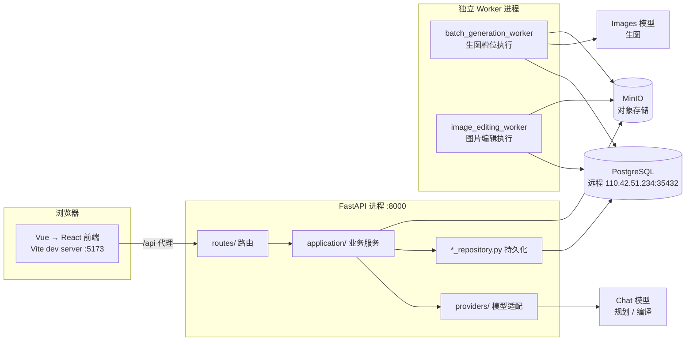
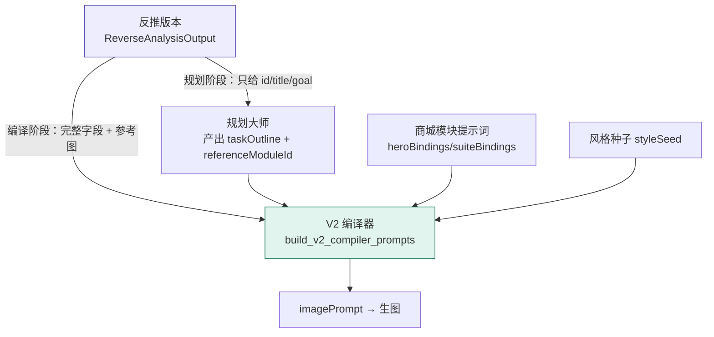
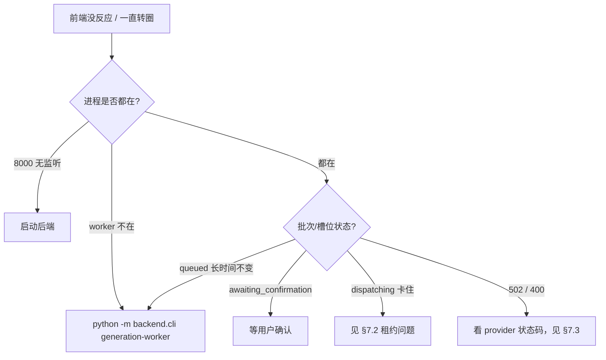

# PicAgent Studio：深度机制与排障手册

整理日期：2026-10-09。本文补充 [learning-and-handoff.md](learning-and-handoff.md)，只记录**宏观文档没有覆盖的实现细节**：提示词商城的绑定与生效时机、反推材料的调用链路、图像编辑的职责切分、已知性能瓶颈与待修缺陷。

阅读前提：已读过学习版的技术栈与业务流程章节。本文所有结论都对应具体的源码位置，可以按图索骥核对。

---

## 1. 系统全景：一次生成涉及哪些进程



**四个进程必须都活着**才能跑通完整链路：前端（Vite）、后端（uvicorn）、生图 Worker、编辑 Worker。

关键认知：

- **Worker 是独立进程**，通过 PostgreSQL 与 API 进程交换任务，不共享内存。API 侧的内存仓储替身无法与 Worker 协作。
- **不启动 Worker 时**，主图/套图确认后会永久停在 `queued`，前端表现为"点了没反应"。
- 启动命令见后端 `cli.py`：`python -m backend.cli generation-worker`。

### 启动入口

| 脚本 | 作用 |
| --- | --- |
| `start-dev.bat` | 同时拉起后端 + 前端 + Worker 三件套 |
| `start-backend.bat` | 仅后端 |
| `python -m backend.cli migrate` | 执行 Alembic 迁移 |
| `python -m backend.cli generation-worker` | 生图执行器，**必须常驻** |

其他 CLI 子命令：`schema-check`、`import-style-seeds`、`baseline-stamp`、`db-reset`、`project-archive-backfill`。

> **日志位置提醒**：后端日志按启动方式不同散落在仓库多处（如 `text-2-image/.tmp-planning-send-backend.out.log`）。
> 项目根目录的 `backend-api-dev.out.log` 可能是**过期文件**，排查前先看时间戳。

---

## 2. 前端：路由与关键组件

### 2.1 路由表（`src/routes/router.tsx`）

技术选型是 **TanStack Router**（`@tanstack/react-router`），全部路由集中在一个文件里声明。

| 路径 | 页面 | 说明 |
| --- | --- | --- |
| `/` `/projects` | `ProjectManagementPage` | 项目管理 |
| `/workspace` | `WelcomePage` | 工作台首页（带 variant A/B/C） |
| `/projects/$projectId` | `ProjectWorkbench` | 项目主工作台，靠 `?tab=` 切换 |
| `/prompts` | `PromptMarketplacePageNew` | 提示词商城 |
| `/tasks` | `TaskCenterPage` | 任务中心 |
| `/generation-config` | `GenerationConfigPage` | 生成配置 / 模块绑定 |
| `/reverse-projects` | `ReverseProjectsPage` | 反推项目列表 |
| `/reverse-projects/$id` | `ReverseProjectDetailPage` | `?tab=references\|overall\|modules\|bindings` |
| `/asset-libraries`、`/product-libraries`、`/test-*` | 素材库 / 商品库 / 测试库 | |

`ProjectWorkbench` 的 `tab` 取值：`base | hero | suite | canvas | reverse | video`。
其中 `video` 会 **redirect 到 `canvas`**（`router.tsx:64-68`）；`/suites/$suiteId/board` 也整体重定向到 `projects/...?tab=canvas`。

> 注意：`ProjectWorkbench` 是 tab 容器，真正的主图/套图工作区是 `HeroImageWorkspace.tsx` 与 `SuiteWorkspace.tsx`。

### 2.2 目录职责

```text
src/
  routes/router.tsx       所有路由声明（单文件）
  pages/                  页面 = 路由目标，负责取数与布局
  features/               业务功能组织
    plan/ suite/ planning/ reverse-projects/
  components/             UI 组件
    image-canvas/         画布与编辑器（见 §5）
    generation-workspace/ 生成工作区子组件
    PromptMarketplace/    提示词商城
  hooks/                  任务恢复与交互
  store/                  Zustand 全局状态
  api/client.ts           统一 HTTP 客户端与响应类型
  lib/                    前端业务辅助逻辑
```

### 2.3 轮询机制（性能相关，见 §7）

多个页面用固定间隔轮询后端：

| 位置 | 间隔 |
| --- | --- |
| `TaskCenterPage.tsx` | `TASK_POLL_INTERVAL_MS = 3000` |
| `WelcomePage.tsx` | 5000 ms |
| `LongImageStylePanel.tsx` | 2500 ms |

这些轮询**没有做请求去重、没有超时中断、页面隐藏时也不暂停**，是后端压力放大的重要来源。

---

## 3. 提示词商城：改了什么才会生效

这是最容易误解的部分。**商城的"模块规划"提示词不参与规划阶段，只在编译阶段生效。**

### 3.1 两个阶段的知识来源

| 阶段 | 入口 | 知识来源 | 读商城？ |
| --- | --- | --- | --- |
| **规划阶段** | `POST /module-plans`（规划大师） | 内置 `backend/app/skills/hero-planning-master/SKILL.md` 或 `suite-planning-master/SKILL.md` | **否** |
| **编译阶段** | `POST /suite-plans/compile`、hero/suite 单图编译 | 商城提示词（经绑定）+ 规划简案 + 风格种子 | **是** |

规划阶段代码（`module_planning_service.py:267-273`）：

```python
skill = load_planning_skill(payload.mode)
system = skill.content + "\n\n" + STYLE_LIBRARY_PLANNING_RULES
```

只拼内置 SKILL.md，商城的模块规划提示词**完全不参与**。

**所以"改了商城提示词但规划结果没变"是正常现象。**

### 3.2 绑定解析（编译阶段）

`hero_prompting.py:150-193` 的 `resolve_module_prompt()`：

```python
MODULE_BINDING_KEYS = {"hero": "heroBindings", "suite": "suiteBindings"}

# 从已发布配置取绑定
published_config["heroBindings"][module_id]   # 或 suiteBindings
```

规则：

1. **未绑定 → 返回空串**，调用方回退到通用规范 `SYSTEM_PROMPT_BASE`。
2. 已绑定 → 按 `promptTemplateId` + `promptVersionId` 取版本正文，并校验 `contentSha256`。
3. **哈希不符报 `GENERATION_CONFIG_PROMPT_CHANGED`**（防止模板被悄悄改动）。

注入方式（`module_planning_v2.py:386`）：

```python
system_prompt = f"【模块表达建议，可在任务目标内调整】\n{bound}\n\n{SYSTEM_PROMPT_BASE}"
```

`plannerBindings` 是**已废弃字段**，保存/发布时会被忽略。

### 3.3 role 保护

`prompt_usage.py:6-13` 定义了规划类 role：`style-seed / style-planner / planner / hero-module-planner / suite-module-planner`。

这些模板在**"直接生图"路径会被拒绝**（报 `PROMPT_REQUIRES_PLANNING`），只能在主图/详情页工作台里使用。

---

## 4. 反推材料 × 规划大师：完整调用链路

反推（Reverse）产出竞品的设计方法，供规划与编译参考。**核心约束：反推只提供信息结构与视觉方法，商品事实必须来自当前项目。**

### 4.1 数据源

`reverse_project_service.py` 产出 `ReverseAnalysisOutput`：

| 层级 | 字段 |
| --- | --- |
| 项目级 | `category / summary / suitableFor / goal / requiredMaterials / notSuitableFor` |
| `overall` | `contentFlow / visualSystem / moduleStrategy / adaptationRules` |
| `modules[]` | `id / title / referenceImageId / goal / layout / informationHierarchy / typography / colorAndLighting / adaptationNotes` |

按**版本（version）**存储，每次编辑产生新版本。

### 4.2 绑定

前端 `src/features/reverse-projects/planning.ts` → `reverseBindingConfigPatch()`：

- `scope === "overall"` → 写入 `config.reverseVersionId`（整套级）
- `scope === "module"` → 写入 `config.reverseModuleReferences[targetModuleId] = {versionId, moduleId}`（单图级）

**`reverseVersionId` 变化时会清空** `modulePlanId / modulePlanFingerprint / modulePlanningRequest / modulePlanReferences`，作废旧规划。

### 4.3 规划阶段：刻意裁剪

`module_planning_service.py:266-290`：

```python
reverse_context = await self.reverse_projects.planning_context(payload.reverseVersionId)
# 注意：不传 module_id
```

不传 `module_id` 时，`modules` 会被裁剪成只剩 `{id, title, goal}` —— **刻意砍掉 `layout / typography`，防止模型照抄版式**。

随后：

- `context["reversePlanning"] = reverse_context`，随 user prompt（JSON）发给规划模型
- system prompt 追加事实隔离约束
- 快照落库（可追溯）

模型输出 `referenceModuleId`，`_validate_output`（338-359 行）校验其**必须 ∈ 本次传入的 module ids**，
否则报 `invalid reverse reference module` → 触发一次纠正重试 → 仍失败返回 502。

### 4.4 编译阶段：完整字段 + 参考图

`suit_planning_service.py:235-269`、`batch_generation_service.py:230+`：

- 前端 `moduleReverseReference()`：优先用手动绑定，否则用 `modulePlanReferences[taskId]`（需 fingerprint 匹配）
- 后端：`selected.reverse_reference` 为空但有 `taskOutline.referenceModuleId` 时**自动回填**
- `planning_context(version, module)` **带 module_id** → 拿到完整模块字段
- `planning_images()` → 取参考图二进制，**作为多模态输入**与源图一起发给编译模型

包装为：

```json
{
  "role": "competitor_design_reference",
  "factPolicy": "只用参考的版式/层级/视觉方法；商品事实必须来自当前项目素材与约束",
  "context": { ... }
}
```

### 4.5 提示词层级

`module_planning_v2.py:397-406`：

- 整体 `reversePlanning` **统管全局视觉规则与内容策略**
- 局部 `reverseReference` **只贡献布局细节，且必须服从整体反推，不能覆盖**



### 4.6 硬约束（必须守住）

反推只提供竞品的**信息结构 / 版式 / 视觉方法**；
**商品事实必须来自当前项目素材与约束**，禁止把竞品参数、功效、价格、认证写成当前商品事实。

---

## 5. 图像编辑：Konva 画交互，PIL 做像素

**结论：前端 Konva 只负责画选区，真正的重绘运算全在后端 PIL。**

### 5.1 依赖与使用范围

`package.json` 含 `konva@^10.3.2` + `react-konva@^19.2.5`，但**只有 2 个文件** import：

| 文件 | 用途 |
| --- | --- |
| `components/image-canvas/ImageEditorModal.tsx`（434 行） | **真正的编辑器**（含局部重绘） |
| `components/ImageEditorDialog.tsx`（23 行） | 旧 demo，按钮是死的（调 `mockEditImage`） |

### 5.2 前端做什么（`ImageEditorModal.tsx:235-254`）

```jsx
<Stage onMouseDown={start} onMouseMove={move} onMouseUp={finish}>
  <Layer visible={tool === "inpaint" && showMask}>
    <Line points={...} stroke="#df5252" opacity={.55} lineCap="round"
          globalCompositeOperation={mode === "erase" ? "destination-out" : "source-over"} />
  </Layer>
</Stage>
```

- `Stage` 捕获指针坐标，归一化成 `0~1`（`position()`，108-111 行）
- `Layer` 用 `Line` 把笔迹画成红色半透明涂鸦 —— 这是**纯视觉反馈**
- `globalCompositeOperation` 实现"绘制/擦除"两种模式（擦除用 `destination-out`）
- 文字框是 `Group + Rect + Text + Transformer`；笔刷光标是 `Circle`

**前端从不做像素运算**，只把 `MaskStroke[]`（`{mode, points[], width}`）序列化成 JSON 发给后端。

### 5.3 后端做什么（`image_editing_rendering.py`）

`operation_mask()`（83-105 行）按坐标重画蒙版：

```python
mask = Image.new("L", size)
draw = ImageDraw.Draw(mask)
for stroke in payload["strokes"]:
    points = [(round(p["x"]*(width-1)), round(p["y"]*(height-1))) ...]
    diameter = max(1, round(stroke["width"] * min(size)))
    draw.line(points, fill=color, width=diameter, joint="curve")
    for x, y in points: draw.ellipse(...)      # 补圆头

feather = payload["feather"] * min(size) * .05
# 羽化只在原选区内混合，保证选区外像素完全不变
mask = ImageChops.multiply(mask, mask.filter(ImageFilter.GaussianBlur(feather)))
```

执行流程（108-172 行）：

1. `validate_operations()` 校验参数
2. 按类型分组（`prompt_edit` / `text` / `masked`），同组共享一次模型调用
3. 生成**红色选区指引图**一起喂给模型（154-156 行）
4. 模型返回后 `Image.composite(candidate, image, mask)` —— **蒙版合成也在后端**
5. `crop_resize` 不调模型，本地 `Image.crop().resize()`

### 5.4 其他画布

- `CanvasStudio.tsx`（434 行）用 **`@xyflow/react`（React Flow）+ `@dagrejs/dagre`**：展示生成任务的节点图（节点 = 生成任务，连线 = 派生关系）。**完全不含 Konva。**
- Konva 与 React Flow 是互补关系，不是竞品。前者管"画像素"，后者管"节点怎么摆、怎么连"。

---

## 6. 数据与配置的关键约束

### 6.1 快照与版本

- `PLANNER_VERSION_V2 = "v2"`、`V2_RENDERER_VERSION = "module-renderer-v2.1"`、`V2_COMPOSER_VERSION = "final-composer-v2.1"`
- 常规版规划契约版本：`regular-design-v1`
- 编译结果、规划结果、生成配置版本**冻结落库**，历史任务不受后续配置变更影响

### 6.2 密钥

`core/model_secrets.py` 的 `ModelSecretCodec`：

- 优先用 Fernet（后端配 `MODEL_CONNECTION_ENCRYPTION_KEY`）
- Windows 无 key 时退回 **DPAPI**（`dpapi:` 前缀）
- 解密失败报 `MODEL_SECRET_UNAVAILABLE`

**换后端用户或换加密密钥会导致旧密文无法解密**，此时环境派生的连接会用当前凭据兜底（`_decrypt_record_key`）。

### 6.3 模型连接与用途

`generation_config.model_connections` 表存连接（base_url + model_name + protocol + 加密密钥）：

| protocol | 用途 |
| --- | --- |
| `openai_images` | 生图（`/v1/images/generations\|edits`） |
| `openai_chat` | 规划 / 编译（`/v1/chat/completions`） |

**重要：`model_connections` 不记录模型是否支持视觉（vision）。** 绑定提示词模型时只校验 protocol 是否为 `openai_chat`（`model_connection_service.py:199-213`），**不校验图片输入能力**。这是一个已知设计缺口，见 §7.3。

---

## 7. 已知问题与排查手册

### 7.1 【未实施】`GET /api/task-center` 响应过慢

**现象**：接口 60 秒不返回（curl 超时）；`/api/projects` 约 1 秒；`/api/health` 仅 3~4 ms（不查库）。

**根因链**：

1. `routes/task_center.py:103-119` 是**串行 N+1**：`for project in projects:` 内逐个调 `_project_tasks()`，
   每个项目再发 3~5 次查询。6 个项目 = **18~30 次查询**。
2. **数据库在远程**（PG `110.42.51.234:35432`）。实测 `SELECT 1` = **111 ms**（纯网络往返），建连 315~1622 ms（波动极大）。
   → 18~30 次往返 = 秒级起步。
3. 表里有**大 JSON 字段**：`module_plans` 25 行 / 1088 KB ≈ **43 KB/行**；`suite_plan_modules` 23 KB/行；
   `generation_module_tasks` 25 KB/行。列表接口若带上这些字段，远程传输会显著放大耗时。
4. 前端 `TaskCenterPage.tsx` **每 3 秒轮询**。接口 60 秒不返回 → 请求堆积约 20 个 → 把连接池占满。
5. `app/db.py:7` 用 `create_async_engine(url, pool_pre_ping=True)`，**未配 `pool_size / max_overflow`**
   → 默认 5+10 = 15 个连接；`pool_pre_ping` 每次取连接还多一次往返。
6. 连接池满后其他接口排队 → 全站变慢。

**优化建议（按性价比排序）**：

1. **task-center 改批量查询**：一次查出所有项目的最新任务（`WHERE project_id = ANY(...)` 或窗口函数），
   把 18~30 次往返压到 2~3 次。**收益最大。**
2. 列表接口**不返回大 JSON 字段**（如 `compile_idempotency*`），详情接口再按需取。
3. 显式配置连接池 `pool_size / max_overflow`，考虑关闭 `pool_pre_ping`（或改设 `pool_recycle`）。
4. 前端轮询**降频 + 防重入**：加超时、请求去重、页面不可见时暂停。
5. 根治：PG 挪到本地/同内网，或加 pgbouncer 类连接池代理。
6. 排查 `idle in transaction` 会话（是否有事务未提交/回滚，导致持锁）。

**已确认的数据事实**（用于反驳"数据量太大"的猜测）：
所有表都在几百行级别。最大的 `suite_workbench.idempotency_keys` 仅 2119 行；
`project_workbench.generation_image_slots` 只有 **61 行 / 136 KB**。61 行的查询不可能慢。

### 7.2 【部分未定位】生成槽位长时间卡在 `dispatching`

**现象**：前端详情套图一直显示"正在请求模型"，进度 `已完成 0/1`，实测卡 9 分钟以上无变化。

**已确认的事实**：

- slot `status = dispatching`、`lease_token` 仍占用、`updated_at` 停在 9 分钟前
- 但 `lease_expires_at` **每 20 秒往后延一次** → **有进程在持续续租**（`lease_seconds=60`，续租周期 = 60/3 = 20s）
- 同时 worker 日志已记录 `outcome=failed_or_cancelled total_s=189.315 provider_s=160.18 persist_s=None`
  → **worker 认为它已结束，但没把状态写回数据库**（persist 阶段被跳过）
- **不是"永久卡死"**：停掉 worker 后 slot **自动恢复**为 `needs_retry`（`error_code=PROVIDER_DISPATCH_UNKNOWN`）

**根因（两个叠加）**：

1. **lease 续租任务泄漏（实测确认，但具体路径未定位）**：
   `_execute_with_lease`（`batch_generation_worker.py:72-91`）的 `finally` 里明明有 `heartbeat.cancel()`，
   但任务（`total_s=189.315`）早已结束而租约在 6 分钟后仍在续。
   而兜底机制 `recover_expired_leases()`（`batch_generation_repository.py:1474`）的 SQL 条件是
   `status='dispatching' AND lease_expires_at <= :at` → 续租不停就**永远不触发**，兜底彻底失效。
   **修复前需先加日志复现，不要只靠静态阅读下结论。**
2. **provider 侧失败**：`generation_slot_attempts` 里错误是 `IMAGE_PROVIDER_FAILED`。
   但实测 provider 根路径正常（httpx 直连与走代理都 HTTP 200，1.3~1.9s），
   所以是**生图接口本身**失败（额度/参数/内容审核/服务端不稳定），不是网络不通。

**设计张力**：`lease_seconds=60` 但 `provider_timeout_seconds=600`，provider 超时是租约的 **10 倍**
→ 任何超 60 秒的生图都必须靠续租协程撑着，**续租一坏就卡**。

**修复方向**：

- 修续租泄漏：在 `_execute_with_lease` 的 finally 里可靠地 cancel 续租 task（先加日志定位）
- 给 recovery 加一条**不依赖租约**的规则：`dispatched_at <= :at - interval '15 minutes'`（阈值要 > provider 超时）
- 恢复卡死的 slot：需**先停 worker**（否则续租协程会把字段写回去），再
  `UPDATE ... SET status='needs_retry', lease_token=NULL, lease_expires_at=NULL`
- 完整分析报告：`item-zuizhong2/worker-lease-bug-report.md`

### 7.3 【未修复】详情套图编译报"提示词模型拒绝了当前图片输入或请求格式"

**现象**：详情套图工作区报 `提示词模型拒绝了当前图片输入或请求格式`，前端显示"本次任务失败 1 个模块"。

**这句话的出处**：`providers/openai_compatible.py:63`

```python
if status_code in {400, 422}:
    return AppError(f"{prefix}_INVALID_REQUEST", "提示词模型拒绝了当前图片输入或请求格式", 502)
```

→ **只要 provider 返回 400/422 就会折叠成这句**，文案会误导人以为是图片本身有问题。

**触发接口**：`POST /api/projects/{id}/suite-plans/compile` → 502。

**已确认的差异**（`suite_planning_service.py:435-452`）：

- **hero 编译**：只发文字提示词，**不传图片** → 一直成功
- **suite 编译**：给模型传 `image_inputs = [源商品图..., 反推参考图...]` → 失败

**旁证**：该项目 `generation_batches` 里**只有 `kind=hero` 的批次，没有 `kind=suite`**
→ 说明套图编译**在写库之前就抛错了**。

**当前绑定**：`api.deepseek.com / deepseek-flash`（`openai_chat`）。

> **待核实的关键点（本次排查未完成）**：
> 实测中 `deepseek-flash` 对**单张小图**能正确返回图中文字，说明它并非完全不支持图片输入。
> 因此 suite 编译失败的**确切触发条件尚未定位** —— 可能是**多图输入**、**图片体积**（源图 1254×1254 / 1.29 MB，
> base64 后约 1.7 MB）、或与 `response_format: json_object` 的组合。
> **结论：不要直接下"模型不支持视觉"的判断，需要继续用真实源图复现。**
>
> 复现思路：用 `generation_config.model_connections` 里 `deepseek-flash` 那条连接，
> 通过 `ModelSecretCodec` 解密 key，直接构造「文字 + 源图 data URL + `json_object`」的请求观察状态码。

**修复方向**：

1. 【推荐】把「生成配置 → 提示词模型」换成**明确支持视觉**的连接
   （`.env` 的 `MODEL_PROFILES_JSON` 里 `capabilities: ["vlm"]` 的项，如 DashScope `qwen3.8-max`），重新发布配置。
2. 【代码加固】`model_connections` 增加 vision 能力标记，绑定提示词模型时校验；
   不支持图片时提前报明确错误码（如 `PROMPT_MODEL_REQUIRES_VISION`），
   而不是让 400 被统一折叠成现在这句含糊文案。

### 7.4 【未修复】`GET /api/products` 抛 `NameError`

```
File "app/application/library_services.py", line 352, in list_products
    if await db.get(ProductLibrary, library_uuid) is None:
NameError: name 'ProductLibrary' is not defined. Did you mean: 'TestProductLibrary'?
```

漏 import（或类名写错），导致商品库接口 500。与上述问题无关。

### 7.5 【环境坑】Alembic MigrationDriftError

**根因**：`core.autocrlf=true` 导致 alembic 迁移文件被转成 CRLF，与数据库登记的 sha256 不符。

**修复**：

```bash
# 33 个迁移文件 CRLF → LF
git add --renormalize .
git config core.autocrlf false
```

### 7.6 排查清单



**端口检查**：

```bash
netstat -ano | grep -E ":8000|:5173"
```

---

## 8. 与既有文档的关系

| 文档 | 定位 |
| --- | --- |
| `learning-and-handoff.md` | 技术栈、架构、业务流程、启动部署（**先读这份**） |
| `interview-and-presentation.md` | 面试讲法、亮点、追问参考 |
| **本文** | 深入机制（商城绑定、反推链路、编辑分工）+ 已知问题排查 |

本文的结论以当前工作区源码为准（含未提交变更）。**§7 中标注"未定位/待核实"的项，不要当成已确认结论使用。**
