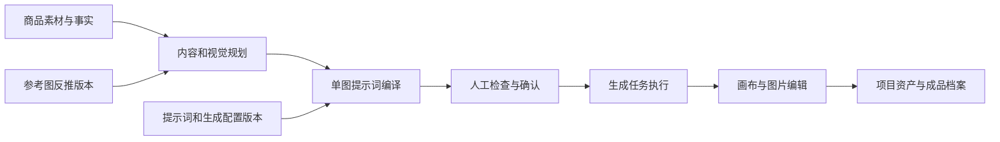
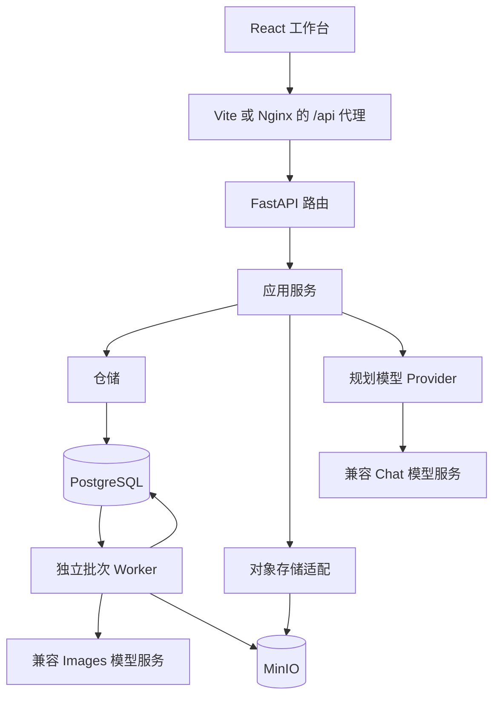
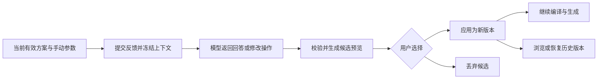
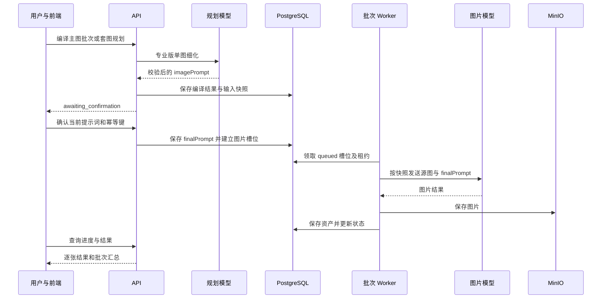
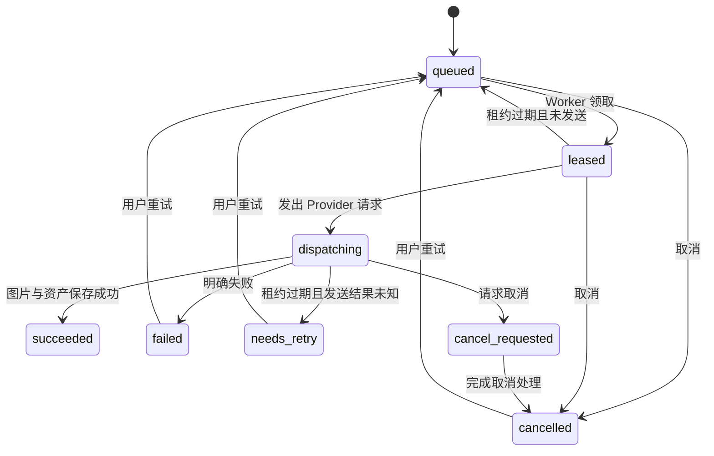

# PicAgent Studio：学习与开发交接

整理日期：2026-10-09。本文以当前工作区源码为准，包括未提交变更。目标是帮助读者理解系统、找到代码入口并继续开发。

## 1. 项目解决什么问题

PicAgent Studio 是面向电商商品图片制作的多模态应用。用户输入商品图片、已确认商品资料和制作要求，系统提供主图与详情套图规划、提示词编译、图片生成、参考图反推、画布编辑和成品归档。

核心业务不是单次“输入文本得到图片”，而是将制作过程保存为可修改、可确认、可查询的项目任务。



源图和用户确认资料提供商品事实。参考图主要提供视觉方法，参考图里的品牌、价格、认证、规格不能自动变成当前商品事实。

## 2. 目录与阅读地图

当前工作区的父目录不是 Git 仓库，前后端各自有独立仓库。

```text
item-zuizhong2/
  text-2-image/                 后端仓库
    backend/app/main.py        应用创建、依赖组装和路由注册
    backend/app/routes/        HTTP 入口
    backend/app/application/   业务流程和业务校验
    backend/app/providers/     模型服务适配
    backend/app/*repository.py 持久化实现及内存替身
    backend/app/core/          配置、身份、错误、密钥等基础能力
    backend/app/skills/        项目内置规划知识
    backend/tests/             后端测试
    backend/cli.py             迁移、Worker 和维护命令
    alembic/                   数据库迁移
    config/                    运行配置资源
    docs/project/              本套项目文档
    openspec/                  需求与变更规格
  text-2-image-front/           前端仓库
    src/routes/                页面路由
    src/pages/                 页面和工作台
    src/features/              规划、套图、反推等功能组织
    src/components/            UI、画布、编辑器
    src/hooks/                 任务恢复和交互逻辑
    src/store/                 Zustand 状态
    src/api/                   HTTP 客户端及接口类型
    src/lib/                   前端业务辅助逻辑
    tests/                     逻辑测试及端到端测试
  output/                      项目介绍和其他交付材料
  tmp/                         临时研究、对比和测试资料
  start-dev.bat                本机启动脚本
```

`backend/`、`alembic/`、`config/` 必须保持同层。配置代码通过 `Path(__file__).resolve().parents[3]` 推导后端根目录。

## 3. 技术栈与实际用途

### 3.1 后端

依赖范围来自 [pyproject.toml](../../pyproject.toml)，它没有提供完整锁定环境。

| 技术 | 声明范围或运行配置 | 实际用途 |
| --- | --- | --- |
| Python | >=3.11；Docker 使用 3.13 | 后端语言与异步执行 |
| FastAPI / Uvicorn | >=0.115,<1.0 / >=0.30,<1.0 | HTTP API 和 ASGI 服务 |
| Pydantic / Pydantic Settings | Settings >=2.6,<3.0；Pydantic 由依赖引入 | 请求、规划结果和环境配置校验 |
| SQLAlchemy Async / asyncpg | >=2.0,<3.0 / >=0.29,<1.0 | PostgreSQL 访问，仓储中也使用参数化 SQL |
| Alembic | >=1.14,<2.0 | Schema 迁移和迁移历史管理 |
| MinIO SDK | >=7.2,<8.0 | 原图、缩略图、生成和编辑结果的对象存储 |
| HTTPX | >=0.27,<1.0 | 调用兼容 Chat、Images 接口及处理网络异常 |
| LangChain / langchain-openai | ~=1.4.3 / ~=1.6.7 | 整体规划的 `create_agent` 和 `ChatOpenAI` 运行时 |
| Pillow | >=10.0,<12.0 | 蒙版、裁剪、文字合成、长图渲染等图像处理 |
| cryptography | >=43,<51 | 模型连接密钥的 Fernet 加解密；Windows 另支持 DPAPI |
| asyncio + 独立 Worker | 项目实现 | 批次图片槽位执行、并发控制和租约续期 |
| Pytest / Ruff | dev 依赖 | 后端验证和静态检查工具 |

PostgreSQL 和 MinIO 是外部基础设施。当前后端 Compose 只定义 API 与 Worker，并不负责创建数据库或 MinIO 服务。

### 3.2 前端与部署

前端版本取自 [package.json](../../../text-2-image-front/package.json)，完整解析结果由该仓库的 `package-lock.json` 管理。

| 技术 | 声明版本 | 实际用途 |
| --- | --- | --- |
| React / TypeScript / Vite | ^19.2.8 / ^7.0.2 / ^8.2.2 | 页面、类型检查、开发代理和构建 |
| Tailwind CSS | ^3.4.17 | 样式工具类 |
| TanStack Router | ^1.170.33 | 当前应用路由和工作台导航 |
| Zustand | ^5.0.15 | 项目草稿、会话标识、生成状态和主题 |
| React Flow / Dagre | ^12.11.3 / ^3.1.1 | 素材、生成步骤与版本关系的节点画布和布局 |
| Konva / react-konva | ^10.3.2 / ^19.2.5 | 图片编辑的文字、选区、变换等交互 |
| TanStack Virtual | ^3.14.11 | 素材列表的虚拟化 |
| JSZip | ^3.10.1 | 图片批量打包下载 |
| lucide-react | ^1.43.0 | 图标 |
| tsx / Playwright | ^4.23.12 / ^1.62.1 | 前端逻辑测试和浏览器端到端验证 |
| Docker / Compose / Nginx / Drone | 仓库配置 | 独立构建前后端、反向代理和部署流水线 |

`react-router-dom`、Langfuse、OpenTelemetry 等出现在前端依赖清单中，但当前主路由使用 TanStack Router。依赖声明或 `.env.example` 里的可观测性字段，不足以证明后端已接通 Langfuse、Prometheus 全链路采集；当前核对到的是请求 ID、日志、Worker 心跳及生图阶段耗时日志。

## 4. 整体架构与责任边界



路由读取请求并调用应用服务；应用服务负责事实边界、版本校验、编译、确认和任务编排；仓储保存状态；Provider 隔离外部模型协议。`main.py` 是当前主要的依赖组装入口，服务通过 `app.state` 提供给路由。

开发及测试可使用内存仓储和内存存储。未配置数据库时，部分需要 SQLAlchemy 服务的功能不会完整启用。API 和独立 Worker 是不同进程，不能通过各自的内存仓储共享任务；完整生成链路需要共同连接 PostgreSQL 和 MinIO。

身份入口目前是 `LocalSingleUserIdentityProvider`：服务端提供固定 actor、workspace 和 role。存在工作区范围检查，不代表已经完成多用户登录、JWT 或商业多租户鉴权。

## 5. 核心业务对象

以下是阅读代码用的概念关系，不是完整数据库 ER 图。

| 对象 | 表达什么 | 容易混淆的边界 |
| --- | --- | --- |
| Project | 商品制作项目 | 不等于单次生成任务 |
| ProjectAsset | 项目素材与输出 | 图片字节在对象存储，关系和元信息在数据库 |
| PromptTemplate / Version | 提示词模板与不可变正文版本 | 默认版本变更作用于新请求，不能重写历史快照 |
| GenerationConfig / ModelConnection | 已发布生成配置与模型连接 | 模型名称、地址可以配置，密钥留在服务端 |
| ModulePlan | 主图或套图的整体任务书 | `moduleId` 表示模块类型，`taskId` 表示本次任务身份 |
| PlanningConversation | 对话修改会话、候选方案与应用版本 | 候选预览不是已经生效的规划 |
| SuitePlan | 套图逐模块编译后的规划 | 包含模块顺序、数量和提示词，确认后关联生成批次 |
| GenerationBatch / ModuleTask / ImageSlot | 批次、模块任务与每张输出 | 一个模块可以对应多个图片槽位 |
| SlotAttempt | 单图的一次执行记录 | 重试继续使用槽位，但执行尝试有独立记录 |
| ReverseProject / Version | 参考图片反推方案 | 复用的是设计方法，不是参考商品事实 |
| ImageEditingSession / Task / Version | 编辑草稿、执行任务和结果版本 | 原图和后续结果通过版本关系追溯 |
| ProductLibrary / ProjectArchive | 成品与项目资产档案 | 测试结果与正式成品应分别管理 |

数据库 Schema 包括 `project_workbench`、`generation_config`、`suite_workbench` 和 `prompt_library`。完整表结构以 `alembic/` 与仓储 SQL 为准。

## 6. 从输入到生成的流程

### 6.1 建立项目与准备素材

1. 创建项目，上传商品源图或从素材库选择图片。
2. 后端保存文件、哈希、尺寸、类型及项目归属，项目资产与档案建立关联。
3. 按需生成白底图或透明图；该入口读取商城专用模板的默认版本。
4. 填写商品事实、输出语言、平台、风格、画幅、分辨率、模块和图片数量。

白底或透明素材生成经图片编辑任务处理，不应归入独立批次 Worker 的同一条队列。

### 6.2 常规版与专业版

| 环节 | 常规版 `regular` | 专业版 `professional` |
| --- | --- | --- |
| 用户输入 | 模块参数、文案、表达方向 | 商品资料、整体需求和设计目标 |
| 内容规划 | 可调用模型分配模块和文案，也可人工编辑 | 多模态整体规划，产出系列策略和逐图任务书 |
| 单图编译 | `regular_design.py` 按本地规则渲染 | V2 单图规划结果提供 `imagePrompt` |
| 修改方式 | 表单调整，也支持对话候选方案 | 任务书、单图参数和对话候选方案 |
| 生图前置条件 | 确认最终提示词与输入 | 确认最终提示词与输入 |

两种模式都关注商品外观和事实限制。常规版的确定性编译能减少这一阶段的模型依赖，但不代表整个模式不调用模型。

### 6.3 专业版整体规划与单图细化

整体规划入口主要在 `module_planning_service.py`：准备源图、参考图、商品事实、模块目录、风格及平台信息，再加载主图或套图对应的项目 Skill。`OpenAICompatibleModulePlanner` 将图片作为 data URL 传入规划 Agent。

当前 Agent 通过 `create_agent(model=chat, tools=[], ...)` 创建。Skill 是服务端读取的知识文本并注入上下文，不是 Agent 自主发现和调用的工具；不能把这一实现描述为 Supervisor 多 Agent 系统。

模型使用 JSON mode 输出，应用服务再使用 Pydantic 和业务规则校验模块 ID、任务关系、字段和边界。整体规划最多执行初次调用加一次纠正调用；SDK `max_retries=0`，避免 SDK 重试与业务纠正叠加。这个纠正预算不能泛化为所有模型入口都相同。

单图细化主要在 `module_planning_v2.py` 和对应编译 Provider。当前 `imagePrompt` 是核心图片描述，`copySummary`、`visualDirection` 等字段用于展示与校验，不能假设图片模型还会读取这些展示字段。要上图的文案必须写进实际提示词。

### 6.4 对话式规划修改

会话按 workspace、project、hero/suite、regular/professional 隔离。



提交 turn 返回 202，由 FastAPI `BackgroundTasks` 执行这一轮反馈。客户端查询结果，不通过该接口直接生图。修改操作包括设置整体字段、调整模块、设置参数、增删模块和重排。

服务使用 `expectedRevision` 和冻结上下文判断并发变化。运行中商品输入、源图、配置等发生变化时，结果可标为 `stale`；历史恢复同样检查当前上下文。模型产生的预览需要显式应用，避免覆盖用户已生效方案或手动修改。

### 6.5 编译、人工修改与确认



上图是专业版批次路径。常规版单图编译使用本地渲染；旧单图入口、反推执行及图片编辑有各自的执行路径。

当前确认服务校验原始编译结果与冻结快照一致，再接受用户确认时提交的非空提示词。`finalPrompt` 使用这份已确认文本，并保存 SHA-256，不会再将原始模板正文偷偷拼回去。因此“编译后的 `imagePrompt`”与“用户编辑后确认的 `finalPrompt`”是两个可能不同的阶段。

主图批次要求提交的模块键完整；套图确认还检查 `expectedPlanRevision`。重复请求依靠幂等键和请求指纹处理，同一个键用于不同输入会产生冲突，而不是默认创建第二份任务。

### 6.6 Worker、状态与恢复

批次状态：`compiling_prompt`、`awaiting_confirmation`、`queued`、`running`、`succeeded`、`partially_failed`、`failed`、`cancel_requested`、`cancelled`。

单图槽位的关键路径：



PostgreSQL 仓储使用行锁与 `FOR UPDATE OF slot SKIP LOCKED` 领取任务；写入结果时检查租约 token，避免旧执行者覆盖状态。Worker 定时续租，并在轮询中恢复过期租约。

最重要的区分是：未发出的任务可以重新排队；已经发出但结果未知的任务进入 `needs_retry`，由用户处理，避免自动重复调用收费的模型。当前实现不能保证外部模型严格 exactly-once，尤其在 Provider 成功与本地结果持久化之间进程退出时。

滚动执行会在空闲容量出现时补领槽位，使用 `AdaptiveConcurrency` 根据成功和失败调整进程内并发。该上限不是跨所有 Worker 的全局限流，多进程部署需要重新评估总并发。

前端 `useTaskRecovery.ts` 每约 1.5 秒查询未结束任务；卸载页面停止查询，刷新后使用保存的会话标识恢复查询，不会因此重新提交生成。

### 6.7 参考图反推、编辑与归档

参考图反推先分析整套视觉策略及每图结构，再允许用户编辑、发布版本。业务项目绑定固定版本，按当前商品事实分配参数、编译和执行。修改商品输入或输出配置会使相关旧编译结果失效；更换参考版本需新建执行方案。

画布展示源图、生成结果和衍生关系；编辑器保存操作草稿，可执行局部修改、文字处理或裁剪。Pillow 负责服务端的确定性图像处理，模型 Provider 负责需要生成的编辑步骤。长图功能保存配方并完成拼接或切片。输出通过项目资产及档案关系管理，不只保存在浏览器。

## 7. 接口导航与响应约定

以下是核心入口，不是完整接口清单。需要查看字段时阅读路由及 Pydantic schema；服务启动后也可访问 FastAPI 默认 `/docs`。

| 能力 | 路径或路径前缀 | 源码入口 |
| --- | --- | --- |
| 项目与资产 | `/api/projects` | `routes/projects.py`、`application/project_asset_service.py` |
| 整体规划 | `/api/projects/{project_id}/module-plans` | `routes/module_plans.py` |
| 对话修改 | `/api/projects/{project_id}/planning-conversations` | `routes/planning_conversations.py` |
| 主图批次编译与确认 | `/api/projects/{project_id}/generation-batches` | `routes/batch_generations.py` |
| 套图编译、模块调整与确认 | `/api/projects/{project_id}/suite-plans` | `routes/suite_plans.py` |
| 单张主图路径 | `/api/projects/{project_id}/hero-generations` | `routes/hero_generations.py` |
| 反推项目与执行 | `reverse-projects` 路由、`/api/projects/{project_id}/reverse-execution` | `routes/reverse_projects.py`、`routes/reverse_execution.py` |
| 图片编辑与白底生成 | 编辑 session/task 及资产生成入口 | `routes/image_editing.py` |
| 画布、长图、风格统一 | 各自路由 | `routes/canvas_generations.py`、`long_images.py`、`style_harmonization.py` |
| 提示词、配置和模型连接 | 各自路由 | `routes/prompts.py`、`generation_config.py`、`model_connections.py` |
| 任务中心与成品库 | 各自路由 | `routes/task_center.py`、`product_library.py` |

统一成功响应为 `{"data": ..., "requestId": "..."}`，错误为 `{"error": {"code": "...", "message": "..."}, "requestId": "..."}`。上传和预览等文件响应不能按普通 JSON 包装解析。需要幂等的入口使用 `Idempotency-Key` 请求头，具体是否必填以路由和服务校验为准。

## 8. 快照、版本与密钥

生成任务保存源图身份及哈希、配置版本、风格或提示词版本、模型连接、规划来源及最终提示词等信息。快照用于解释“这张图依据什么生成”，并让确认或重试使用冻结输入，而不是自动读取最新模板。

提示词商城风格种子可通过 `python -m backend.cli import-style-seeds` 导入。已导入风格的新请求使用商城默认版本并冻结来源；更新默认版本后下一次新编译生效。历史规划要采用新风格，应重新规划。风格正文是上下文，不能直接当成完整生图指令。

模型连接密钥在服务端加密。配置 Fernet 主密钥时使用 Fernet；Windows 未配置时可用当前用户 DPAPI。非 Windows 部署应提供有效 `MODEL_CONNECTION_ENCRYPTION_KEY`。跨机器迁移要同时考虑数据库、图片文件和密钥，只有数据库备份不足以恢复完整应用。

## 9. 本地启动与部署交接

### 9.1 前置条件

- Python >=3.11；Docker 后端镜像当前使用 Python 3.13。
- 安装支持当前 Vite 版本的 Node.js；前端 Docker 构建使用 Node 24。
- 可连接的 PostgreSQL 与 MinIO，业务数据迁移已完成。
- 已填写后端配置，并在生成配置中配置规划和图片模型连接。

后端环境模板：[.env.example](../../.env.example)。实际密钥只写本机配置，不写进文档。

### 9.2 本地开发

在后端仓库根目录运行，已有 `.env` 时不要覆盖：

```powershell
python -m venv .venv
.\.venv\Scripts\Activate.ps1
python -m pip install -e ".[dev]"
if (-not (Test-Path .env)) { Copy-Item .env.example .env }
# 填好 .env 的数据库、存储和模型配置后执行
python -m backend.cli migrate
python -m uvicorn backend.app.main:app --host 127.0.0.1 --port 8000
```

另一个终端在同一后端仓库和环境运行 Worker：

```powershell
python -m backend.cli generation-worker
```

第三个终端在前端仓库运行：

```powershell
npm ci
npm run dev -- --host 127.0.0.1 --port 5173
```

前端访问 `http://127.0.0.1:5173`，Vite 将 `/api` 代理到 `http://127.0.0.1:8000`，可用 `VITE_FASTAPI_PROXY_TARGET` 覆盖。

父目录的 `start-dev.bat` 一次启动 API、Worker 和前端，但绑定了本机 Python 和 Node 路径。`start-backend.bat` 只启动 API。换机器时先检查路径，不把这些脚本当通用安装器。

### 9.3 配置值的来源

| 项目 | `Settings` 默认值 | `.env.example` 示例值 |
| --- | --- | --- |
| 图片服务超时 | 1,800,000 ms | 600,000 ms |
| Worker 并发 | 3 | 1 |
| Worker 轮询 | 1,000 ms | 1,000 ms |
| 租约时长 | 60 s | 60 s |
| 每次领取上限 | 4 | 4 |

实际以进程环境和 `.env` 覆盖后的配置为准，不应直接把默认值写成生产运行参数。`PG_SSL`、`MINIO_REGION`、`OBSERVABILITY_*` 等模板字段，也不能只凭名称假定已由当前 `Settings` 消费。

### 9.4 Docker 与 CI

在后端仓库执行：

```bash
docker compose -p text-2-image build
docker compose -p text-2-image run --rm api python -m backend.cli migrate
docker compose -p text-2-image up -d
docker compose -p text-2-image ps
```

在前端仓库执行：

```bash
docker compose -p text-2-image-front build
docker compose -p text-2-image-front up -d
```

前端默认对外端口为 `18081`。Nginx 通过 `host.docker.internal:8000` 访问同一宿主机的 API。Linux 部署中该别名指向宿主机网关；API 若只发布到 `127.0.0.1`，前端容器可能无法访问，需要按后端 `.env.example` 配置 `PICAGENT_API_BIND` 为实际 Docker 网关地址。旧 README 的“只绑回环”说明需结合这一最新配置理解。

Nginx 配置在构建时复制进镜像，改反代端口或超时后需要重新构建。当前反代读写超时为 600 秒，后端代码默认图片请求超时更长，增加后端超时时也要检查同步请求经过的代理预算。

Drone 当前负责检出指定提交、构建和启动服务，没有运行数据库迁移，也没有配置独立的业务测试步骤。Schema 变更需按部署计划单独执行迁移。共享服务器操作应明确 Compose 项目名，避免误操作其他服务。

### 9.5 自检与问题定位

```powershell
Invoke-RestMethod http://127.0.0.1:8000/api/health
Invoke-RestMethod http://127.0.0.1:8000/api/ready
Invoke-RestMethod http://127.0.0.1:8000/api/generation-worker/status
```

`health` 是 API 存活检查，不能证明模型服务和 Worker 都正常；`ready` 检查配置的存储、数据库和部分业务仓储；Worker 状态用于确认其心跳。三者不能互相替代。

| 现象 | 优先检查 |
| --- | --- |
| 页面可打开，接口 502 | API 是否启动、Nginx 的网关地址及 API 发布地址 |
| 已确认批次一直 queued | Worker 是否常驻、心跳、API 与 Worker 是否连接同一数据库 |
| 编译返回 503 | 规划模型连接、商城默认版本和必要配置 |
| 确认返回 409 | revision 过期、幂等键复用、输入已经变化 |
| 单图进入 needs_retry | 已发送的 Provider 请求结果不确定，先核查执行记录再人工重试 |
| 图片生成成功但档案异常 | 项目资产、对象存储及档案关联是否保存完整 |
| 刷新后看不到运行任务 | 保存的会话或批次 ID、服务端详情查询和任务恢复逻辑 |

## 10. 开发与验证路线

后端命令在后端根目录执行：

```powershell
python -m pytest backend/tests
python -m ruff check backend
```

前端命令在前端根目录执行：

```powershell
npm test
npm run typecheck
npm run build
npm run test:e2e
```

这是交接用的验证命令，不表示本次文档整理已经执行它们。部分 PostgreSQL 和模型相关测试需要各自前置条件。Playwright 默认在 4177 启动开发服务器；`test:e2e` 脚本只选择一组测试文件，不覆盖目录下的全部用例。修改对话规划或人工提示词时，应额外运行对应 spec。

建议沿一条请求读代码：前端 `HeroImageWorkspace.tsx` 或 `SuiteWorkspace.tsx` → `src/api/client.ts` → 后端对应 route → 编译与确认 service → `batch_generation_repository.py` → `batch_generation_worker.py` → Provider 与资产保存。

| 改动目标 | 优先阅读与验证 |
| --- | --- |
| 常规版表达规则 | `regular_design.py`；`test_regular_design.py`、`test_regular_mode.py` |
| 整体规划与 Agent | `module_planning_service.py`、`providers/planning_agent.py`；`test_planning_agent.py` |
| 专业版单图提示词 | `module_planning_v2.py`、`providers/openai_compatible.py`；`test_prompt_compiler_provider.py` |
| 手动确认提示词 | 两种 confirmation service；`test_manual_generation_prompts.py` |
| 对话修改与版本 | conversation service、patch、repository；`test_planning_conversation_*.py` |
| 队列和租约 | batch repository、Worker；`test_batch_generation_worker.py`、`test_generation_rolling_worker.py` |
| 模型连接和密钥 | `model_connection_service.py`、`core/model_secrets.py`；model connections 测试 |
| 画布和图片编辑 | `CanvasStudio.tsx`、`ImageEditorModal.tsx` 与编辑服务；对应 Playwright 用例 |

## 11. 当前边界与后续改进

当前已有：两种制作模式、规划知识注入、结构化结果校验、对话候选方案与版本、批次槽位和租约、源图与配置快照、编辑及项目归档。

需要与现有能力区分的后续方向：多用户鉴权、统一管理所有后台任务的执行框架、模型输出质量评估与用户反馈闭环、真正的检索增强知识库、工具调用 Agent、跨 Worker 全局限流、完整可观测性接入。

系统保存历史和修改反馈，不等于模型会自动学习；提供生成约束，不等于能保证每张图片事实完全正确。相关能力需要额外实现和效果验证。

返回：[项目文档入口](README.md)；继续：[面试与项目讲解](interview-and-presentation.md)。
