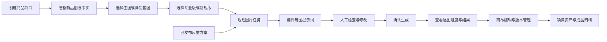
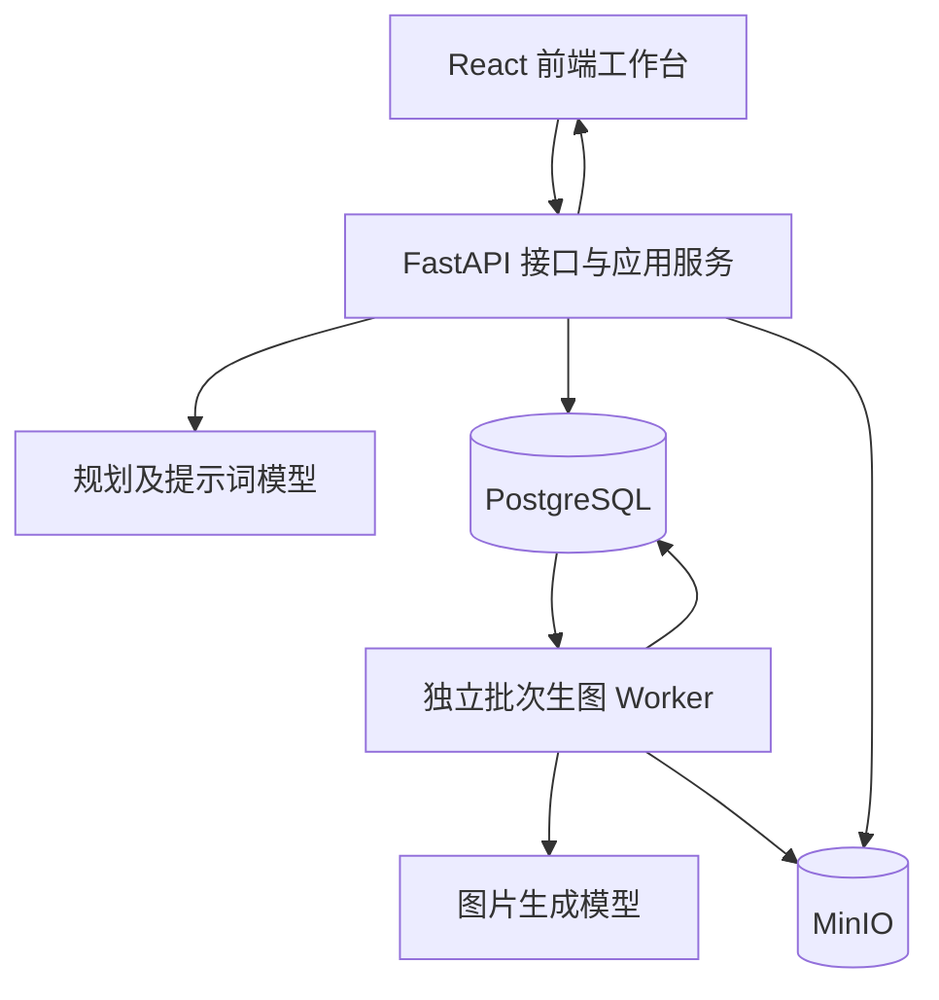
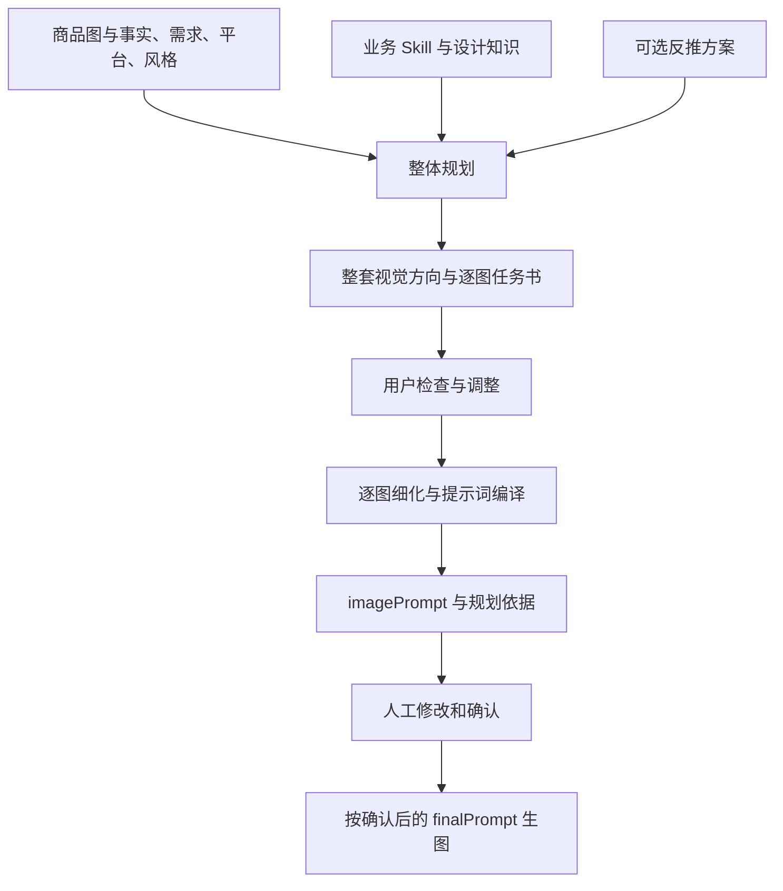
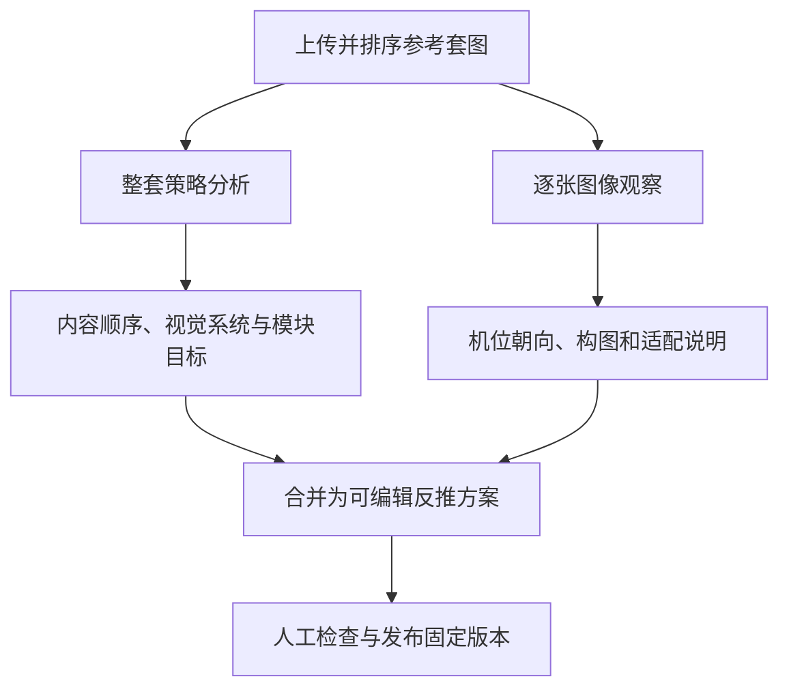
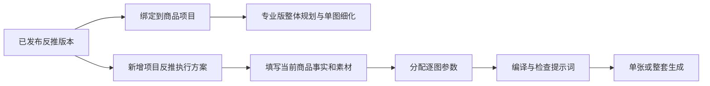
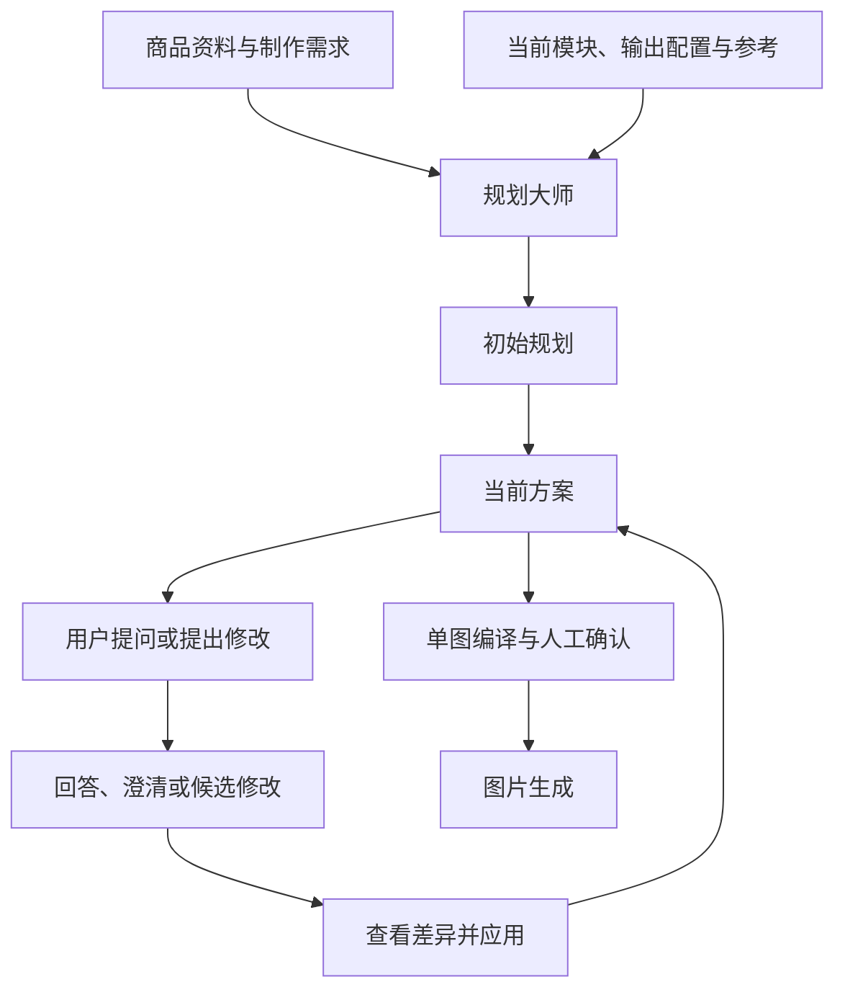
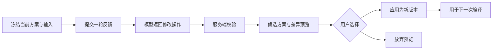

# PicAgent Studio 项目演示稿

整理日期：2026-10-09。根据当前工作区实现编写，包含尚未提交的变更。适合边展示页面边讲解，建议时长 15 至 20 分钟。

演示主线：**整体运行流程 → 专业版与常规版的设计 → 反推的设计 → 规划大师的设计 → 结果与版本管理。**

本文示例仅用于演示输入和讲解，不代表已经取得的模型输出或测量结果。

## 一、先讲整体运行流程

### 1.1 开场介绍

> 这个项目叫 PicAgent Studio，主要用于电商商品主图和详情套图制作。
>
> 用户提供商品图片、商品资料和制作要求，系统先规划每张图片应该表达什么，再把规划转换成实际生图提示词，经过用户确认后调用图片模型。生成的结果可以继续编辑，并保留在项目资产和成品档案中。
>
> 我先展示整个制作流程，再介绍两种创作模式、参考图反推，以及规划大师如何帮助用户生成和修改方案。

### 1.2 用户看到的整体流程

> 这里有三个需要区分的环节：规划决定“每张图讲什么”，编译决定“图片模型具体怎么画”，确认决定“本次实际采用哪个提示词”。规划和编译完成时，还没有启动这个批次的图片生成。

### 1.3 每一步输入和产出是什么

| 步骤 | 用户操作 | 系统产出 | 演示时强调 |
| --- | --- | --- | --- |
| 建立项目 | 新建项目、准备素材 | 项目与素材记录 | 制作过程围绕项目保存 |
| 提供事实 | 填写商品资料和需求 | 当前商品事实与制作约束 | 商品参数以用户确认资料为准 |
| 选择输出 | 选择主图或套图、模式及输出配置 | 本次任务配置 | 两种模式适配不同制作需求 |
| 规划 | 手动组织模块或使用规划大师 | 模块顺序、目标、文案或设计任务书 | 整套图片需要内容分工 |
| 编译 | 将任务与参数转换成提示词 | 每张图的可编辑提示词 | 编译结果可以检查与修改 |
| 确认 | 确认当前提示词 | 冻结输入、最终文本和生成任务 | 用户看到的确认文本用于本次生成 |
| 执行 | 查看进度 | 单图结果和批次汇总 | 一张失败不等于整套结果丢失 |
| 后处理 | 编辑、比较或拼接图片 | 新结果与版本关系 | 生成后仍能继续完善 |

### 1.4 系统内部怎样运行

> 前端负责输入、方案展示和任务查询。FastAPI 负责校验、规划、编译、确认以及保存业务状态。PostgreSQL 保存项目、版本、任务和图片关系，MinIO 保存图片文件。
>
> 主图批次和套图确认后，独立 Worker 从数据库领取每张图片的任务并调用图片模型。前端持续查询进度，所以刷新页面后可以继续读取已经提交的任务。

补充说明：这张图描述批次生图主路径。对话反馈、图片编辑和反推执行有各自的执行入口，不能把它们全部说成同一个独立 Worker 队列。

### 1.5 开始操作

1. 打开项目管理，进入准备好的商品项目。
2. 展示商品源图、素材列表和项目工作台。
3. 指出工作台中的商品素材、主图、套图、项目反推和画布入口，按实际页面名称讲解。
4. 进入主图或详情套图，展示模式、平台、风格、画幅、语言等配置。

建议用同一个商品贯穿演示，例如已有的台灯或其他实物商品。下面的“台灯、三张套图”只是假设案例，参数应替换成实际商品资料。

## 二、专业版与常规版的设计

### 2.1 为什么设计两种模式

> 不同制作任务需要的规划深度不同。有些任务已经知道要展示什么，只需要把模块、参数和文案组织好；另一些任务需要系统先决定整套图片的结构，以及每张图的视觉表达。
>
> 因此项目提供常规版和专业版。常规版侧重内容参数和规则编译，专业版侧重整体视觉规划和单图细化。它们共享素材、生成配置、确认和结果管理。

| 维度 | 专业版 | 常规版 |
| --- | --- | --- |
| 更适合的任务 | 需要整套设计、构图变化和视觉策略 | 已有模块目标，追求参数可控与模板复用 |
| 规划重点 | 整体视觉方向、信息分工、逐图设计任务书 | 内容目标、建议文案和商品参数分配 |
| 单图编译 | 模型展开画面描述，输出 `imagePrompt` | 服务端规则组织任务、事实和视觉要求 |
| 用户控制 | 修改任务书、设计要求和最终提示词 | 修改目标、文案、参数及最终提示词 |
| 对话修改 | 支持 | 支持 |
| 图片执行 | 确认后调用图片模型 | 确认后调用图片模型 |

两种模式是规划和编译方式的区别，不能仅用“质量高低”概括，也不能承诺专业版每次结果必然更好。

### 2.2 专业版：整体规划与单图细化

#### 第一层：整体规划

> 专业版先把整套图片作为一个任务处理，确定每张图的职责和它们之间的关系。例如第一张建立商品识别，第二张解释一个已确认卖点，第三张展示实际使用关系。这样的安排可以减少多张图反复表达同一内容的问题。

整体规划会考虑：

- 整套共享的视觉方向。
- 每张图需要回答的信息问题和内容目标。
- 商品是否出场，以及完整、局部、细节或场景中的出场方式。
- 构图方向、版式、主体比例，以及与上一张的差异。
- 可采用的设计指导、视觉模板和表达方法。
- 已确认事实、缺失信息和需要避免的内容。

这些是当前规划协议中的设计职责，不等于图片模型已经完成了每一项视觉要求。

#### 第二层：单图细化

> 整体任务书确定后，每张图再根据自己的目标、商品资料和约束细化为实际画面描述。比如使用场景图，需要描述商品如何参与场景、主体位置、画面关系和允许出现的文字，而不是只写“生成一张使用场景图”。

当前专业版单图结果中的 `imagePrompt` 是主要生图文本。文案摘要、画面说明和可见事实用于确认界面展示；如果文字要出现在图片中，必须写进实际提示词。

用户可以在确认界面修改提示词。最终发送的是确认后的 `finalPrompt`，它可能与最初编译的 `imagePrompt` 不同。

#### 为什么分成两层

> 整体规划解决整套图片如何分工，单图细化解决当前图片如何落地。分开之后，用户既能检查整体逻辑，也能单独调整某一张图，问题发生时更容易找到修改位置。

这两层由业务服务组织，属于业务职责分层；当前实现不是多个自主 Agent 通过 Supervisor 互相分派任务。

#### 专业版现场演示

1. 选择“专业版”，展示商品图、需求及输出设置。
2. 打开“规划大师”，填写需求并执行“初始规划”。
3. 展示整套说明和各图任务，重点解释目标、构图建议和商品出场方式。
4. 调整某张图的参数或设计要求。
5. 编译提示词，展示一张图的实际文本与规划依据。
6. 修改一处画面描述，确认生成少量图片。
7. 查看逐图进度，随后展示已经准备好的结果。

演示需求示例：

> 基于当前商品图与已确认资料，规划三张详情图：第一张建立商品识别，第二张展示真实材质细节，第三张表现书桌使用场景。整套保持风格一致，但不要重复同一机位和背景。只使用已经提供的商品事实，不添加未确认的性能或认证。

### 2.3 常规版：内容规划与规则编译

> 常规版把更多控制权放在模块参数上。内容规划负责给模块分配目标、文案和事实，编译阶段由服务端本地规则组织商品信息、模块方向、风格及输出要求，然后交给图片模型生成。

#### 常规版怎样组织一张图

| 输入 | 作用 |
| --- | --- |
| 模块类型 | 确定当前图片承担的内容职责，例如主视觉、细节或使用场景 |
| 内容目标 | 说明这张图希望传达什么 |
| 商品参数 | 提供当前图允许采用的事实与要求 |
| 文案策略 | 可选择固定原文，或基于事实灵活组织文案 |
| 视觉要求 | 补充场景、商品行为和表达限制 |
| 风格与输出设置 | 约束整体气质、语言、画幅和分辨率 |
| 套图上下文 | 提醒当前图与其他模块互补，避免重复 |

规则中包含商品外观与事实限制、模块表达方向和套图一致性要求。风格一致不等于所有图片使用相同背景；不同模块仍应有不同场景、景别或表现方式。

#### 常规版里的规划大师做什么

> 常规版也可以让规划大师帮助分配内容，但这里使用的是轻量规划协议，重点返回标题、内容目标、建议文案和模块参数，不要求模型制定完整构图、字体和视觉架构。

因此，常规版的“本地规则编译”不代表整个流程完全不调用模型。需要图片生成时，两种模式都要调用图片服务。

#### 常规版现场演示

1. 切换到“常规版”，使用同一商品资料。
2. 选择两到三个模块，展示每项参数可以直接编辑。
3. 展示一次轻量内容规划，解释目标、文案及参数分配。
4. 修改某个参数，例如“场景：书桌”或已确认的尺寸。
5. 展示固定文案与灵活文案策略的选择。
6. 编译一张图，说明这一阶段由本地规则组织提示词。
7. 展示确认界面和准备好的结果。

> 用同一商品对比可以看出：常规版侧重“把已知需求组织成可控输入”，专业版增加“整套设计任务书和逐图视觉细化”。用户都可以在最终确认时修改本次提示词。

## 三、反推的设计

### 3.1 反推解决什么问题

> 用户有时能够提供喜欢的参考套图，却很难完整描述它的信息顺序、构图和视觉方法。反推模块把参考图片拆成可编辑、可保存版本的设计方案，之后用于当前商品制作。
>
> 复用的是图片如何组织信息和表达视觉的方法。当前商品的参数、品牌和功能仍然来自当前商品资料。

### 3.2 为什么同时分析整套和单图

> 整套分析关注图片之间的关系，逐图观察关注当前图到底如何摆放主体、采用什么视角。代码把这两部分分开，避免整套总结里笼统的描述替代具体图片的观察结果。

| 层级 | 分析内容 | 后续用途 |
| --- | --- | --- |
| 整体介绍 | 适用品类、目标、所需素材、不适合的情况 | 判断参考方案是否适合当前商品 |
| 整体反推 | 内容组织、视觉体系、模块策略和适配原则 | 给整体规划提供方向 |
| 模块拆解 | 单图目标、布局、信息层级、字体、配色光影及适配说明 | 给对应图片的细化提供具体方法 |
| 发布版本 | 保存本次已确认的拆解与参考来源 | 保持复用依据固定，供历史追溯 |

当前分析会检查参考图与模块逐张对应，防止漏图或多个模块错误引用同一参考图。拆解结果仍需要用户检查，结构校验不能证明视觉判断完全正确。

### 3.3 反推方案如何进入制作流程

有两条复用路径：

1. **作为规划参考**：将已发布版本绑定到业务项目，整体规划读取整体策略与模块目标，单图细化读取匹配模块的详细设计信息及需要的参考图。
2. **直接创建反推执行方案**：在“项目反推”中选择固定参考版本，提供当前商品图、事实和参数需求，再进行参数分配、提示词编译和图片生成。

两条路径都有自己的上下文和服务入口，不应把“绑定方案”和“立即按方案生成”说成同一个动作。

### 3.4 为什么要固定版本

> 参考方案会不断完善，如果业务项目始终读取最新草稿，同一制作任务的设计依据就可能在中途变化。因此先发布版本，再绑定或创建执行方案。后续编辑留在草稿，原任务仍然有固定参考依据。

执行方案不允许直接替换参考版本，需要采用另一个版本时新建方案。商品事实、源图或模块结构发生变化时，系统会使相关参数分配或旧提示词失效，要求重新准备或编译。

### 3.5 反推现场演示

1. 进入“反推项目”，展示准备好的参考图及顺序。
2. 点击“开始整套反推”，或者打开已完成的分析。
3. 展示“整体反推”，解释内容顺序和视觉体系。
4. 展示“模块拆解”，对照一张原图说明布局与适配方法。
5. 修改一条分析说明，展示草稿可以人工完善。
6. 展示“发布版本”和“绑定到业务项目”。
7. 回到商品项目的“项目反推”，展示当前商品资料、参数分配、提示词及已有生成结果。

讲解示例：

> 参考图里的“前景细节加背景使用场景”是一种构图方法，可以复用；但参考商品标注的功率、价格或认证不能继承。这里填入的事实来自当前商品，生成时采用的是“参考方法加当前商品资料”。

## 四、规划大师的设计

### 4.1 规划大师在系统里的位置

> 规划大师是用户组织和修改图片方案的入口。用户可以给出商品资料和制作目标，让它产生初始规划，也可以针对现有方案提问或要求修改。
>
> 它先产出可检查的方案，用户应用后才进入后续编译。规划、方案应用和图片生成是不同动作。

### 4.2 它使用哪些输入

| 输入来源 | 内容 | 作用 |
| --- | --- | --- |
| 商品素材 | 当前项目的商品图片 | 提供商品外观依据 |
| 用户资料 | 商品事实、目标、备注 | 明确允许表达的信息 |
| 运行配置 | 平台、模块目录、风格、语言和画幅 | 限定可采用的任务与输出条件 |
| 专业版知识 | 主图或套图 Skill、设计知识与模板目录 | 提供业务规则和设计方法 |
| 可选参考 | 参考图或已发布反推上下文 | 提供视觉方向与适配线索 |
| 当前方案 | 已应用规划和手动修改 | 让对话修改针对当前有效输入 |

常规版采用轻量内容规划上下文；专业版加载更完整的设计知识与输出协议。不能把两种模式讲成仅仅更换一个模型名称。

### 4.3 底层如何构建

> 整体规划的模型运行时使用 LangChain 的 `create_agent`，通过 `ChatOpenAI` 接入可配置的兼容服务。商品图和参考图以多模态输入发送，业务知识与输出要求由服务端组织。
>
> 模型返回 JSON 后，还需要 Pydantic 和业务规则检查模块类型、任务身份和引用是否有效。专业版整体规划如果未通过校验，允许一次纠正调用，仍不合法就返回错误。

当前 `create_agent` 的工具列表为 `tools=[]`。Skill 通过上下文注入，并不是 Agent 自主检索或调用的工具。现场可以称它为“有业务知识约束的多模态规划 Agent”，不要延伸成自主工具执行或多 Agent 协作系统。

### 4.4 对话修改为什么先预览再应用

> 用户可能同时调整参数，模型也可能误解修改要求，所以模型回复不直接覆盖当前方案。先展示候选和差异，用户确认应用后才成为新版本；如果不合适，可以放弃。

模型可以返回普通回答、澄清或修改方案。修改操作受协议限制，包括整体字段修改、模块修改、参数调整、增删模块与重排。应用时检查 revision 和上下文变化；如果模型运行期间源图、事实或配置已经变化，候选可能过期，需要重新处理。

版本历史保存已应用方案。恢复旧版本也需要检查当前上下文，不能把旧版本的输入限制默默套用到已经改变的商品上。

### 4.5 规划大师现场演示

1. 在专业版套图工作台打开“规划大师”。
2. 展示“商品信息与规划需求”，执行“初始规划”。
3. 先提出解释性问题，例如：“为什么把第二张安排成材质细节？”
4. 再提出明确修改，例如：“把第二张改成局部特写，保留其他模块和已确认参数，不新增功能宣称。”
5. 展示候选方案与差异，说明它还没有覆盖当前规划。
6. 点击“应用修改”，展示当前方案变化。
7. 打开“版本历史”，展示已应用记录；时间允许且输入未变时再演示恢复。
8. 回到编译界面，展示新规划用于下一次提示词编译。

> 这里体现的是用户与模型共同完善方案：模型提出修改，系统校验，用户决定是否应用。系统保存这些修改历史，但当前没有根据反馈自动训练模型或更新经验库。

## 五、生成结果与演示收尾

### 5.1 为什么可以逐张查看与重试

> 确认后的批次按图片拆成槽位，独立记录等待、执行、成功或失败状态。Worker 使用数据库租约领取任务，成功后保存图片与来源关系。前端查询这些状态，能够逐张展示结果。
>
> 生成失败时可以针对单图处理。已经发出请求但结果不确定时，系统会进入需要人工重试的状态，避免无判断地自动重复调用收费模型。

### 5.2 展示最终结果

1. 展示一组已完成套图，对比不同模块表达的内容。
2. 在画布里定位一张图，展示生成依据或版本关系。
3. 打开图片编辑器，展示可保存的编辑操作；时间有限时只做一次修改。
4. 展示项目资产或成品档案，以及图片下载。

收尾讲解词：

> 今天展示的是从商品资料到成品图片的一条制作链路。专业版负责整体设计与单图细化，常规版负责内容参数与规则编译；反推让已有参考方法可以复用，规划大师支持用户通过对话完善方案。
>
> 最后通过确认、任务执行、版本记录和资产归档，把一次生成变成可以继续修改和追溯的项目过程。

## 六、现场演示顺序与准备

### 6.1 建议时间分配

| 时长 | 展示内容 | 应讲清的重点 |
| --- | --- | --- |
| 2 分钟 | 项目定位、整体流程和素材 | 规划、编译与生成的区别 |
| 4 分钟 | 专业版 | 整体任务书与单图细化 |
| 2 分钟 | 常规版 | 参数控制与规则编译 |
| 3 分钟 | 反推项目与复用 | 整套加逐图分析、发布版本、商品事实边界 |
| 4 分钟 | 规划大师对话修改 | 候选预览、应用与版本 |
| 2 分钟 | 已有结果、画布及归档 | 可继续编辑与追溯 |

专业版演示已执行初始规划，规划大师章节复用该方案继续修改，避免重复跑同一轮初始规划。

### 6.2 演示前准备

- 准备一个商品项目，至少一张清晰源图，以及可核实的商品资料。
- 准备两到三张参考图、一个已分析并发布的反推版本。
- 准备专业版、常规版和反推路径的历史结果，明确说明它们是预先生成的案例。
- 确认生成配置已经发布，规划与图片模型连接可用。
- 确认 PostgreSQL、MinIO、API、批次 Worker 和前端可用。
- 演示时控制图片数量；实时生成耗时较长，可以提交后继续讲设计，再切回看结果。

已有启动方式见 [学习与开发交接](learning-and-handoff.md)。不要为了演示重置已有数据库或覆盖配置。

### 6.3 现场遇到等待或失败时

| 情况 | 演示处理 |
| --- | --- |
| 规划模型响应较慢 | 展示已有方案，说明当前请求仍在等待，继续讲输入与输出设计 |
| 图片生成耗时较长 | 展示当前进度，再打开预先生成的历史案例 |
| 候选修改过期 | 展示提示，解释上下文变化保护，再重新提交或采用已有案例 |
| 批次停在等待生成 | 检查 Worker 心跳及是否与 API 使用同一数据库 |
| 外部模型请求失败 | 说明实际失败状态，展示重试入口和历史结果，不把历史结果说成实时输出 |

## 七、技术追问时的代码入口

正文以演示为主，下面用于需要展开实现时定位源码。

| 设计点 | 主要源码 |
| --- | --- |
| 整体应用与依赖 | [main.py](../../backend/app/main.py) |
| 专业版和常规版规划协议 | [module_planning_service.py](../../backend/app/application/module_planning_service.py) |
| 专业版单图细化 | [module_planning_v2.py](../../backend/app/application/module_planning_v2.py) |
| 常规版编译 | [regular_design.py](../../backend/app/application/regular_design.py) |
| 规划 Agent | [planning_agent.py](../../backend/app/providers/planning_agent.py) |
| Skill 加载 | [planning_skills.py](../../backend/app/application/planning_skills.py) |
| 对话候选与版本 | [planning_conversation_service.py](../../backend/app/application/planning_conversation_service.py) |
| 反推分析与发布 | [reverse_project_service.py](../../backend/app/application/reverse_project_service.py) |
| 项目反推参数与编译 | [reverse_execution_service.py](../../backend/app/application/reverse_execution_service.py) |
| 最终提示词确认 | [batch_generation_confirmation_service.py](../../backend/app/application/batch_generation_confirmation_service.py)、[suite_planning_confirmation_service.py](../../backend/app/application/suite_planning_confirmation_service.py) |
| 批次图片执行 | [batch_generation_worker.py](../../backend/app/application/batch_generation_worker.py) |
| 规划大师界面 | [PlanningConversationDialog.tsx](../../../text-2-image-front/src/features/planning/PlanningConversationDialog.tsx) |

相关文档：[学习与开发交接](learning-and-handoff.md)、[面试与项目讲解](interview-and-presentation.md)、[文档目录](README.md)。
